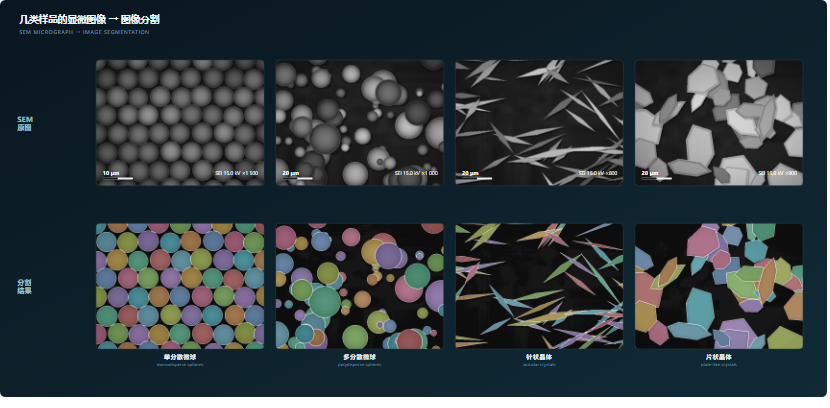

### Hi, I'm Bryan 👋

I work on **microstructure image analysis** — turning microscope images into numbers you can
defend: segmentation, particle and crystal quantification, and pipelines someone else can run.

- **Now** — instance segmentation and quantitative characterization of microspheres and crystals
  from SEM images. Classical algorithms as the backbone, deep models only where they earn their keep.
- **Care about** — reproducible measurements, error bars that are honest, tools that survive
  contact with real samples.
- **Earlier** — master's work on unpaired photo → ink-wash landscape translation (CycleGAN with
  edge, texture, geometry and semantic constraints).

**Selected work**

- **[micrograph-synth](https://github.com/BryanZhan/micrograph-synth)** — synthetic micrographs with
  pixel-perfect instance masks. Five specimen presets, one command, deterministic seeds.
- **[Ink-wash style transfer](https://github.com/BryanZhan/Generative-Adversarial-Network-for-Landscape-Ink-Wash-Painting-Style)** —
  unpaired photo-to-ink-wash translation, CycleGAN plus four consistency constraints.

`Python` · `NumPy` · `OpenCV` · `scikit-image` · `PyTorch`

微结构图像处理 · 图像分割 · 定量表征
