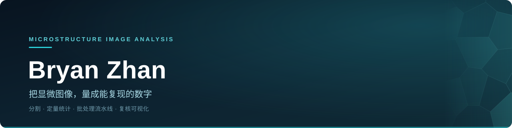

  
   
  

  <b>微球与晶体的显微图像分析</b> 
  球状颗粒、针状与片状晶体的分割、定量统计 · 从原始图像到可复核的报告

显微图像为合成示意图 · 分割结果以彩色掩膜叠加显示

 

## 开源项目

- **[micrograph-synth](https://github.com/BryanZhan/micrograph-synth)** — 合成显微图像与像素级真值：等轴晶粒、单分散 / 多分散微球、针状与片状晶体。一条命令出图 + 掩膜 + 逐颗粒统计；纯 NumPy + Pillow，MIT。
- **[Generative-Adversarial-Network-for-Landscape-Ink-Wash-Painting-Style](https://github.com/BryanZhan/Generative-Adversarial-Network-for-Landscape-Ink-Wash-Painting-Style)** — 硕士阶段：无配对的「照片 → 水墨山水」风格迁移，CycleGAN 之上加了边缘 / 水墨质感 / 几何 / 语义四组约束。

 

Microstructure image analysis · instance segmentation · particle &amp; crystal quantification · reproducible pipelines

